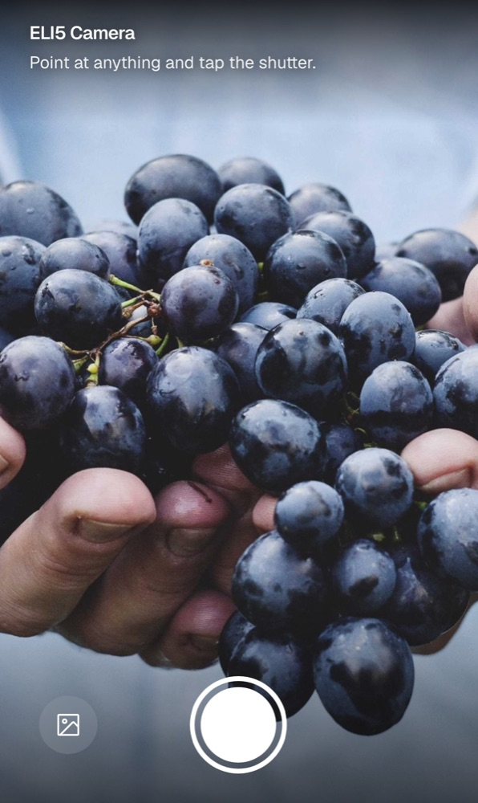
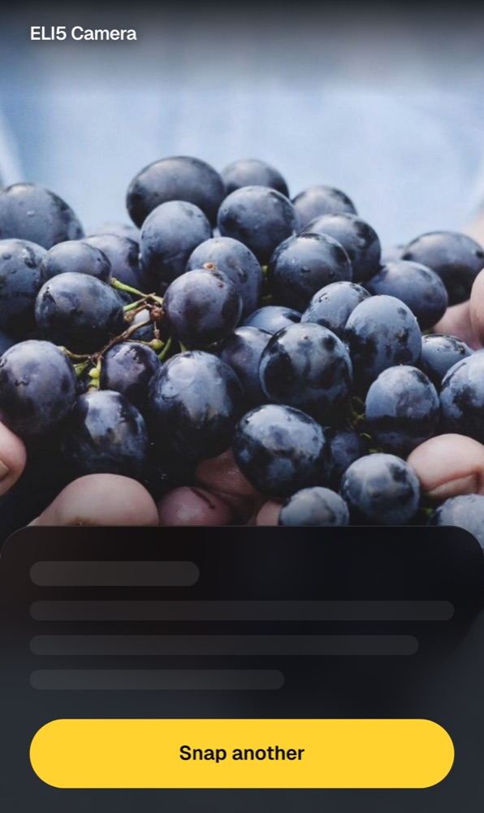
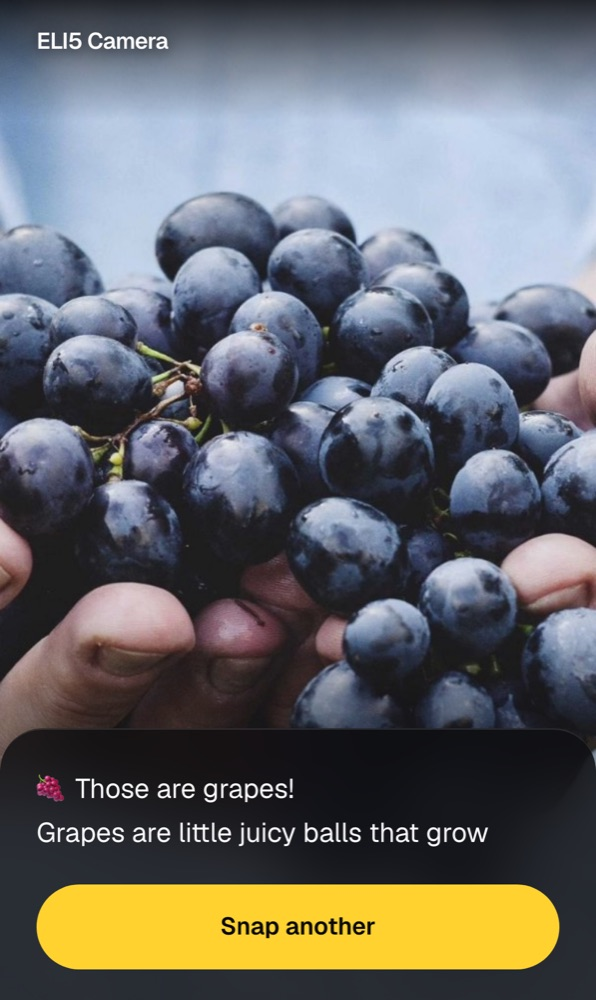
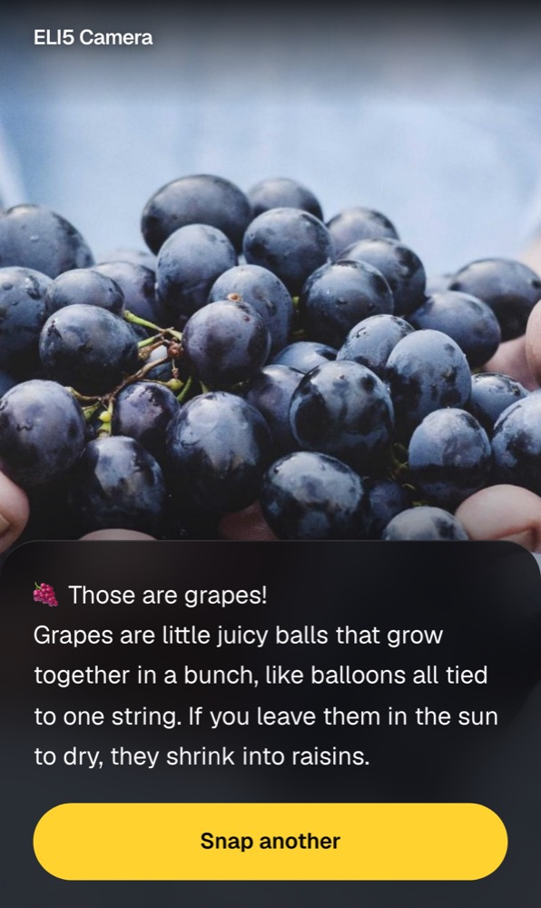
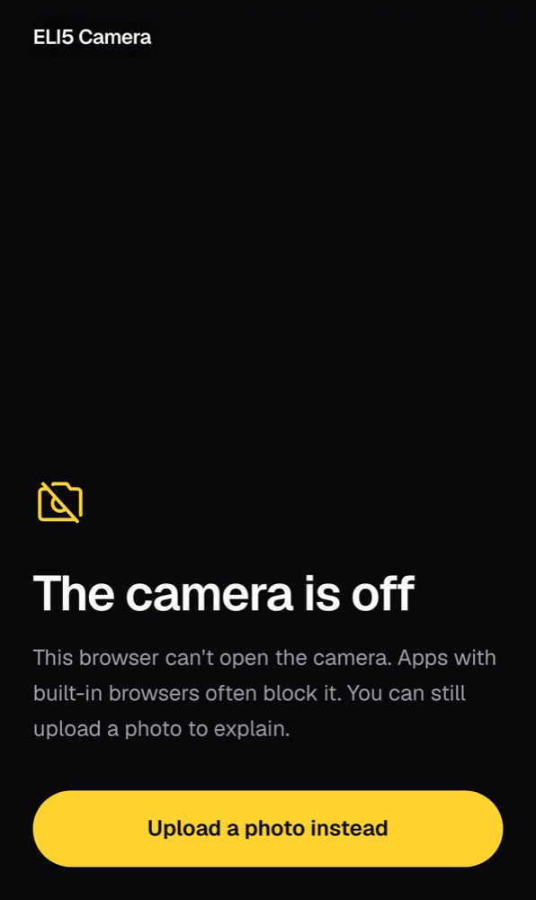
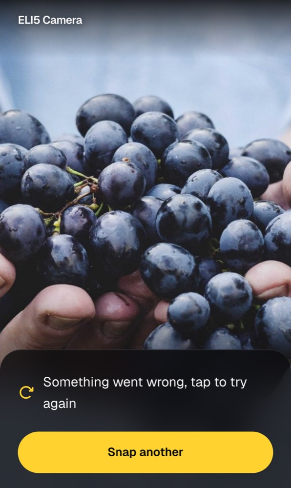
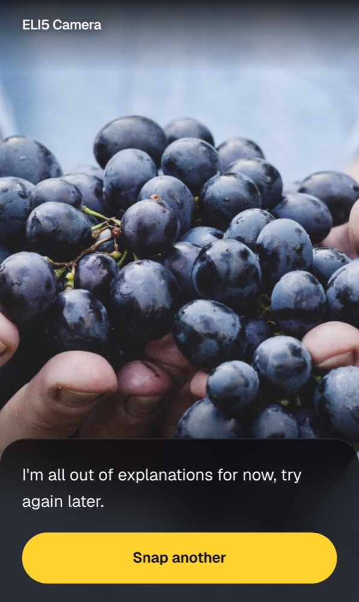

# ELI5 Camera

Point your phone at anything and get it explained like you're five.

ELI5 Camera is a mobile web app that opens straight into your rear camera.
Tap the shutter, the frame freezes, and a short, plain-language explanation streams in word by word.
Every answer starts with an emoji and the name of the thing, then explains it in 2-4 simple sentences with one comparison a child would get.
A switch above the shutter changes the level to "Like I'm 15" or "Expert" for a deeper answer, and switching after a snap re-explains the same photo.

It runs on Gemini's free tier and Vercel's free Hobby plan, so it costs nothing to run.

## Screenshots

| Point at something | Thinking | Streaming in | Done |
| :---: | :---: | :---: | :---: |
|  |  |  |  |

| Camera blocked | Something went wrong | Out of free explanations |
| :---: | :---: | :---: |
|  |  |  |

Screenshots are taken at iPhone 15 Pro size with a sample photo and sample answers, so they look the same every time.

## How it works

1. The app asks for the rear camera with `getUserMedia`.
   If the camera is blocked, missing, or the page is inside an in-app browser, it offers a photo upload instead.
2. The shutter freezes the exact video frame.
   The frame (or the uploaded photo) is shrunk to a max side of 1024px and encoded as JPEG, so uploads stay small on mobile data.
3. The client posts the image to `POST /api/explain`.
4. The route checks the upload, sends it to Gemini with the system prompt, and streams plain text back.
5. The answer sheet renders the text as it arrives, over the bottom of the frozen photo.
   Tap "Snap another" or the photo to go back to the live camera.

### The explain route

| Request | Response |
| --- | --- |
| One image in the `image` form field, and an optional `level` field (`5`, `15`, or `expert`, default `5`) | `200`, streamed plain text |
| No file, or not a JPEG / PNG / WebP / HEIC | `400` |
| Unknown `level` | `400` |
| Image over 4 MB | `413` |
| Gemini free quota used up | `429`, shown as "I'm all out of explanations for now" |
| Any other model failure | `502` after one quiet retry, shown as "tap to try again" |

## Tech stack

- [Next.js](https://nextjs.org) 16 (App Router) with React 19
- [AI SDK](https://ai-sdk.dev) 7 with the Google provider, using `gemini-3.5-flash-lite`
- Tailwind CSS v4, Geist, and Phosphor icons
- Vitest for the route tests

## Run it locally

You need Node.js 22+, pnpm, and a free Gemini API key from [Google AI Studio](https://aistudio.google.com/apikey).

```bash
pnpm install
echo "GEMINI_API_KEY=your-key-here" > .env
pnpm dev
```

Open [http://localhost:3000](http://localhost:3000).
On a laptop it uses your webcam, or the upload button if no camera is available.
`localhost` counts as a secure context, so the camera works there without HTTPS.

To try it on your phone, deploy a Vercel preview (below) and open its URL.
Phones need HTTPS for the camera, so a plain `http://192.168.x.x:3000` link from your laptop falls back to upload.

## Scripts

| Command | What it does |
| --- | --- |
| `pnpm dev` | Start the dev server |
| `pnpm build` / `pnpm start` | Production build and server |
| `pnpm test` | Route tests with a mock model (never calls Gemini) |
| `pnpm typecheck` | TypeScript check |
| `pnpm lint` | ESLint |

## Deploy to Vercel

```bash
vercel link
vercel env add GEMINI_API_KEY preview
vercel deploy
```

The key has no `NEXT_PUBLIC_` prefix, so it stays on the server and never reaches the page.

## Project layout

```
app/
  page.tsx                 the single screen
  eli5-camera.tsx          camera stream, shutter, freeze, upload fallback
  explanation-panel.tsx    sends the photo, streams the answer, error and quota states
  level-switch.tsx         the "Like I'm 5 / 15 / Expert" switch
  api/explain/
    route.ts               POST /api/explain
    explain.ts             validation, model call, status mapping
    prompt.ts              the system prompt for each level
    explain.test.ts        route tests with a mock model
lib/
  levels.ts                the levels, shared by the page and the route
  model.ts                 the one place the model is chosen
  prepare-image.ts         shrink any image to a 1024px JPEG
```

### Switching models

The model lives only in `lib/model.ts`.
To move to a paid model, change that one line, for example to Claude Haiku 5.5 through `@ai-sdk/anthropic`.
Add a passcode or a rate limit in the same change, because the route has no auth and a paid key can run up a bill.

## Privacy

Photos go to Google's free Gemini tier, and Google may use free-tier inputs to improve its models.
Don't snap anything you wouldn't want to share.
The app keeps no history and stores nothing.

## Future scope

Right now the app gives one short paragraph and stops, and it is shaped around one idea: ELI5.
The plan below turns it into a real product: "understand anything around you in plain language", for kids and adults alike.
ELI5 becomes one setting, not the whole identity.

### Before launch

These come before any new feature.

- **Move off Gemini's free tier.**
  Google may use free-tier inputs to train its models.
  Real users will snap medical bills, contracts, and their homes, so a paid product can't make that privacy promise on the free tier.
- **Rate limit and accounts.**
  The route has no auth today, so one script could drain the quota or, on a paid model, run up a bill.
  Required before switching to a paid model, as noted in `app/api/explain/route.ts`.
- **Installable app.**
  Ship it as a PWA with an icon and splash screen, or as a native app, so it feels like a product and not a browser tab.
- **Accuracy and safety guardrails.**
  Medical, legal, and safety answers need clear limits, such as "this is general info, check with a professional".
  An adult acting on a wrong answer is a real liability.

### Core upgrades for everyone

- **Remember the level.**
  The level resets to "Like I'm 5" on every visit; save it on the device so adults don't switch it each time.
- **Ask follow-up questions.**
  Add a "Why?" button and a short follow-up chat under each answer, such as "is it safe?" or "how much does it cost?".
  Each step stays at the chosen level, so understanding builds in small bites instead of one big paragraph.
- **Answer cards.**
  Switch from one paragraph to a small card with the name, what it is, what it's for, and one fun fact.
  Short labeled parts are easier to scan than a block of text.
- **Voice in and out.**
  Ask out loud and hear the answer.
  This helps hands-free use, accessibility, and children who can't read yet.
- **Point at a part.**
  Tap or circle one region of the photo to explain just that, and draw a soft outline around the object being explained.
- **Tap a word to explain it.**
  When a harder word slips in, make it tappable to get a one-line explanation of just that word.
- **"Is it safe?" note.**
  Add a clear, friendly warning for things that are hot, sharp, poisonous, or not to be touched.
- **More languages.**
  Let people choose the language of the answer, which also opens up large non-English markets.

### Modes for adults

- **Explain a document.**
  Snap a bill, lease, insurance letter, medical report, or tax form and get what it means and what you need to do.
  This is likely the strongest reason for adults to pay.
- **Explain a label.**
  Food ingredients, medicine leaflets, skincare, and laundry symbols, in plain words.
- **"Is this a good deal?"**
  Snap a product or price tag to learn what it is, what it's for, and what to watch out for.
- **Fix-it mode.**
  Snap a warning light, error screen, or broken appliance to learn what's wrong and the next step.
- **Travel mode.**
  Snap a sign, menu, monument, or dish and get it translated and explained in context.
- **Study mode.**
  Snap a textbook page, diagram, or equation and get it explained step by step.
- **Work mode.**
  Snap a chart, slide, or whiteboard and get the key takeaway.

### Modes for kids

- **Kids mode with parent controls.**
  Today the prompt is written for adults using an ELI5 style.
  A real kids mode needs a stricter prompt, content filters, and a parent setting to turn it on.
- **Show how big it is.**
  Compare the size to things a child knows, like "as long as your arm" or "as heavy as a cat", with a small picture next to it.
- **Tap to choose.**
  When a photo has several things in it, let the child tap the one they're curious about.
- **Guess first.**
  Before revealing the answer, ask "What do you think it is?" to turn each snap into a small game.
- **Daily discovery.**
  Suggest one thing to go find each day ("find something that floats"), to get kids exploring away from the screen.

### Remembering and sharing

- **History and collections.**
  Save every snap, search past answers, and group them into folders.
  For kids, show it as a sticker book with each snap's emoji and name.
- **Share card.**
  Turn a snap and its explanation into a well-designed picture card to send to family or post online.
  Every share is free marketing.
- **Works offline for common things.**
  Cache answers for everyday objects so the app still works on a weak connection.

### Business model

- **Freemium.**
  A few free snaps a day, then a plan at around $3-5 a month for unlimited snaps, document mode, history, and voice.
- **Family plan.**
  Kids mode with parent controls plus adult mode on one subscription.
- **Partnerships later.**
  Museums, zoos, and schools license a branded "explain this exhibit" version.

### Standing out

Google Lens, ChatGPT's camera, and Apple Visual Intelligence already cover parts of this.
The edge is speed and simplicity: one tap gives an instant, plain-language answer with no chat needed.
Keep the camera-first, zero-setup feel, and don't turn into another chatbot.

### Suggested order

1. Paid model, rate limit, and installable app.
2. Document and label explainer.
3. Follow-up questions and history.
4. Share cards.
